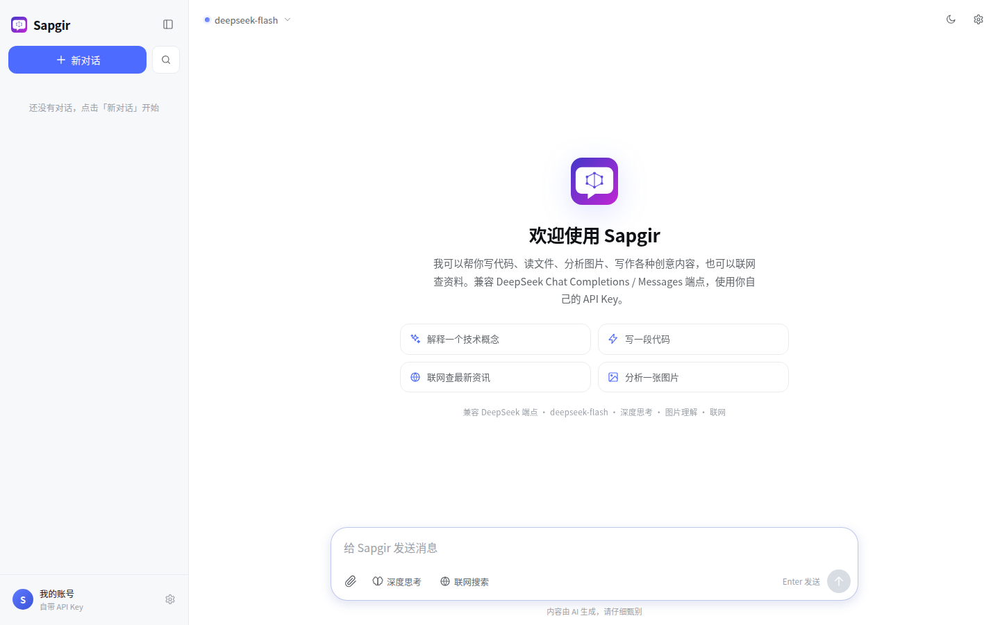
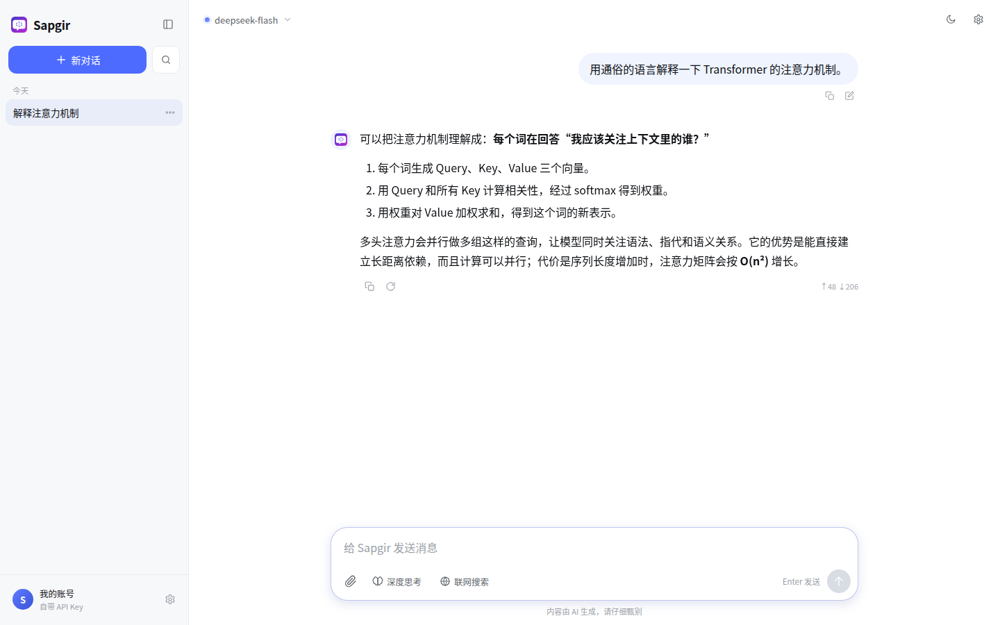
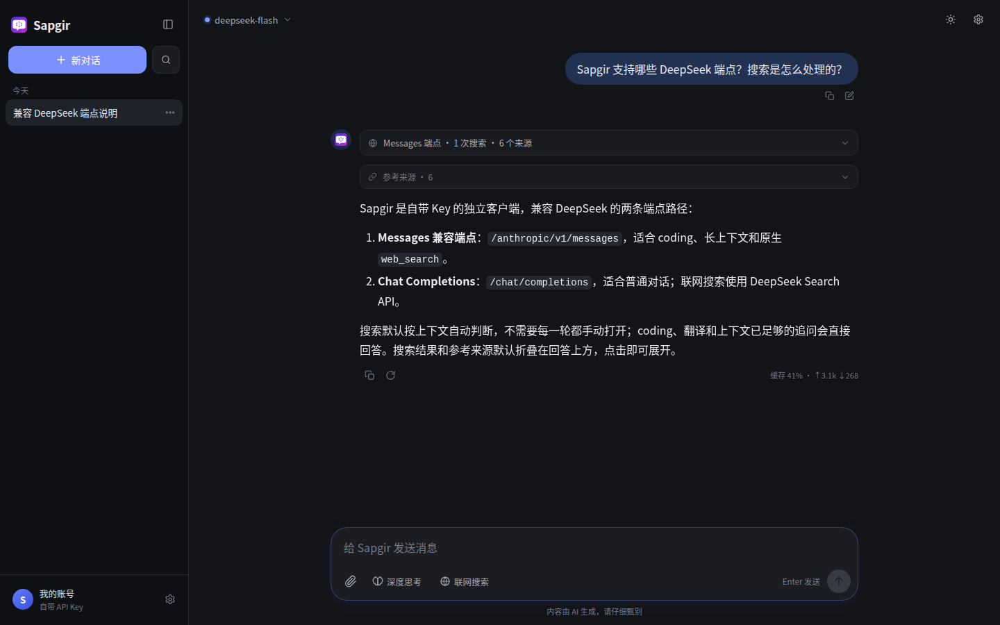
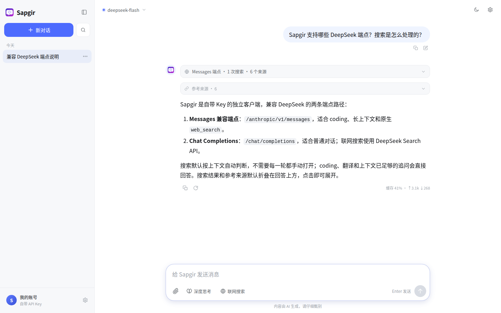
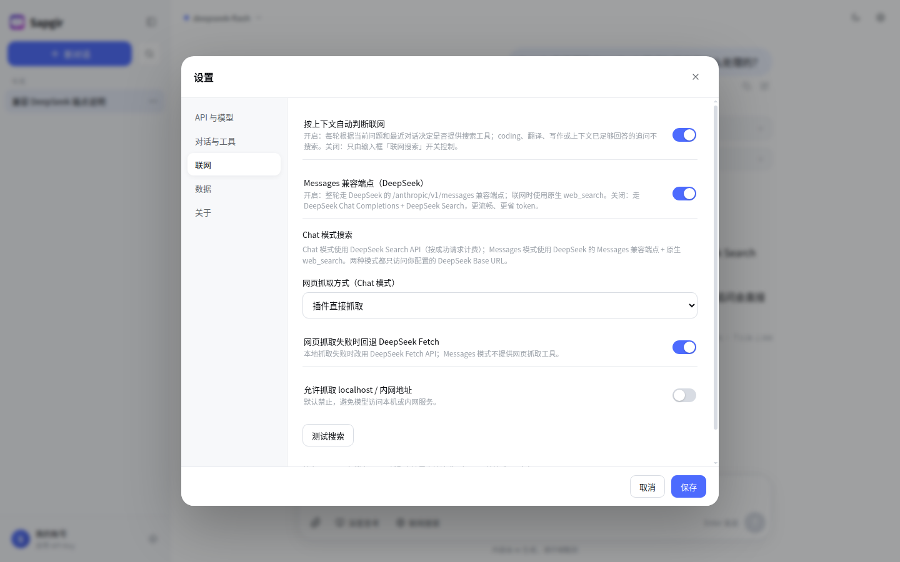
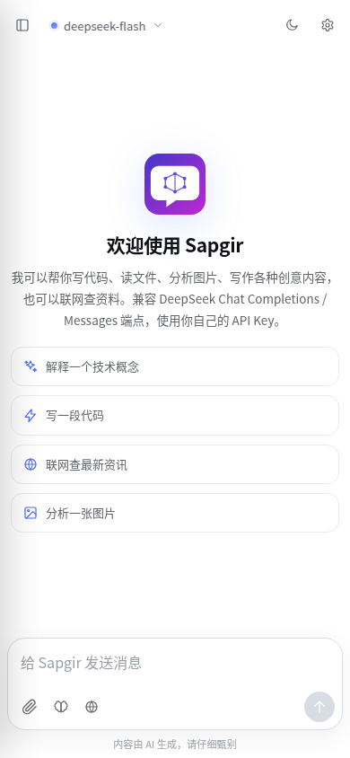
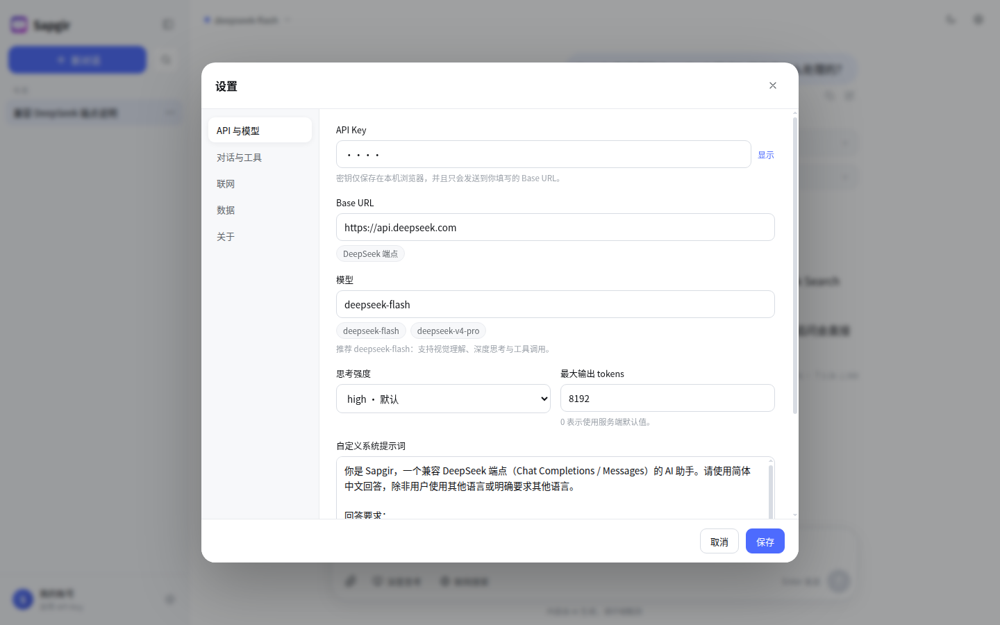

# Sapgir

> 兼容 DeepSeek Chat Completions / Messages 端点的自带 Key AI 聊天扩展。  
> 纯本地运行，无中转服务器、无遥测；不隶属于 DeepSeek 官方。

<p align="center">
  
</p>

<p align="center">
  
  
</p>

<p align="center">
  
  
</p>

<p align="center">
  
  
</p>

---

## 品牌

当前使用原创图标 **Lattice Bubble**：气泡 + 节点网络，源文件为 `assets/icon.svg`，并已导出 16–512px PNG。

项目名 **Sapgir** 致敬俄罗斯诗人 **Genrikh Sapgir（1928–1999）**；仅作为项目名称，不代表其遗产或相关权利方，也不使用其肖像或诗作。

## 功能

- **自带 API Key**：兼容 DeepSeek 端点和任意 OpenAI 兼容的 Base URL；支持自定义模型名、测试连接、查看可用模型。
- **两种 DeepSeek 端点**：
  - **Messages 兼容端点（默认）**：`POST /anthropic/v1/messages`，适合 coding、原生搜索和长上下文。
  - **Chat 模式**：`POST /chat/completions`，更适合普通对话；搜索走 DeepSeek Search API。
- **默认 `deepseek-flash` 原生多模态**：上传 / 粘贴 / 拖拽图片（JPG、PNG、GIF、WebP），自动压缩后以 base64 发送；支持多图、图片预览大图、历史图片回放。
- **按上下文联网**：默认自动判断是否需要搜索。只有最新/实时/新闻/价格/天气/版本等需要外部信息的问题，或用户明确要求搜索时，才向模型提供搜索工具；coding、翻译、写作、上下文已足够的追问不搜索。
- **搜索与来源默认折叠**：搜索过程和参考来源放在回答上方，默认收起，点击标题展开，不挤占正文。
- **深度思考**：开关、`low / high / max` 思考强度、实时展示思考过程与耗时，可自动折叠。
- **append-only 上下文**：稳定 system 快照 + 隐藏工具调用记录，让同一对话的请求前缀保持不变，最大化 DeepSeek 的前缀缓存命中；用量区会显示「缓存 xx%」。
- **完整 Markdown**：GFM 表格、任务列表、代码高亮、代码复制、引用链接、KaTeX 公式（`$$...$$`、`\(...\)`、`\[...\]`）。
- **本地优先**：对话和设置保存在 `chrome.storage.local`，可导出 / 导入备份，导出文件不包含 API Key。
- **附加能力**：文本文件附件、对话搜索、重命名、置顶、删除、Markdown 导出、右键菜单「用 AI 解释 / 总结页面」。

## 安装

要求 **Chrome / Edge 116+**。

1. 下载或克隆本目录。
2. 打开 `chrome://extensions/`，开启右上角 **开发者模式**。
3. 点击 **加载已解压的扩展程序**，选择本项目根目录（包含 `manifest.json` 的目录）。
4. 在工具栏固定扩展图标，点击图标即可打开聊天页。
5. 首次打开会自动弹出设置：
   - **API Key**：在 [platform.deepseek.com](https://platform.deepseek.com/) 创建。
   - **Base URL**：默认 `https://api.deepseek.com`。
   - **模型**：默认 `deepseek-flash`（推荐，支持图片理解）。
   - 可点击 **测试连接** 验证 Key 和网络。
   - **联网**：默认开启 **Messages 兼容端点**；开启「按上下文自动判断联网」后，不需要每轮手动打开搜索。Chat 模式的搜索使用 DeepSeek Search API。
   - 点击 **保存**。

> 扩展页会在新标签页中打开；再次点击工具栏图标会聚焦已打开的页面，不会打断正在进行的对话。

## 使用

- **发送**：`Enter` 发送，`Shift + Enter` 换行。可在设置中改为 `Ctrl/⌘ + Enter` 发送。
- **深度思考**：输入框左侧的「深度思考」开关；思考过程会实时显示，回答开始后自动折叠。
- **联网搜索**：默认按上下文判断。当前问题需要最新/外部/可核实信息时，自动向模型提供搜索工具；模型再决定是否实际调用。
  - **Messages 兼容端点（默认）**：整轮走 `/anthropic/v1/messages`。需要联网时使用 DeepSeek 原生 `web_search` 服务端工具；不需要时不带工具，适合 coding。
  - **Chat 模式**：整轮走 `/chat/completions`；需要联网时使用 DeepSeek Search API，不依赖第三方搜索 provider。
  - 输入框的「联网搜索」是手动强制开关；想完全自动，保持它关闭。
  - 搜索结果和「参考来源」默认折叠在回答上方；点击搜索摘要或来源标题可展开。
- **网页抓取（Chat 模式）**：默认由插件直接请求 URL、用 Turndown 转成 Markdown；失败时可回退 DeepSeek Fetch API。Messages 模式不提供插件 `web_fetch`。
- **图片**：点击回形针、直接粘贴截图，或把图片拖进页面；发送前可点击缩略图查看大图。
- **文本文件**：支持 `.txt / .md / .json / .csv / .py / .js / .ts / .html / .css / .sql / .yaml` 等常见文本文件。
- **对话管理**：侧边栏支持搜索、重命名、置顶、删除、导出 Markdown。
- **快捷操作**：
  - `Ctrl / ⌘ + K`：搜索对话
  - `Alt + N`：新对话
  - `Esc`：关闭菜单 / 弹窗
- **右键菜单**（在任意网页上）：
  - 「用 AI 解释“选中内容”」
  - 「用 AI 总结此页面」

## 模型与 API

扩展有两条 DeepSeek 端点路径，由 **设置 → 联网 → Messages 兼容端点（DeepSeek）** 切换：

**Chat 模式** 使用 OpenAI 兼容的 **Chat Completions**：

```text
POST {baseUrl}/chat/completions
Authorization: Bearer <API_KEY>
```

**Messages 兼容模式（默认）** 使用 DeepSeek 的 Messages 兼容接口：

```text
POST {baseUrl}/anthropic/v1/messages
x-api-key: <API_KEY>
anthropic-version: 2023-06-01
```

- 默认模型：`deepseek-flash`（原生视觉理解、长上下文、支持工具调用）。
- 也支持 `deepseek-v4-pro`、`deepseek-chat`、`deepseek-reasoner` 或自定义模型名。
- Chat 模式思考参数：`thinking: { type: "enabled" | "disabled" }` + `reasoning_effort: "low" | "high" | "max"`。
- Messages 模式思考参数：`thinking: { type: "enabled" | "disabled" }` + `output_config: { effort: "low" | "high" | "max" }`。
- Chat 模式图片以 `image_url` + `data:image/...;base64,...` 发送；Messages 模式图片以 base64 image block 发送。

### Append-only 上下文与缓存

- 对话开始时快照一条 system message，之后不再逐轮重写；
- 每轮只追加新的 user / assistant 消息；
- Chat 模式把工具调用和结果保存在隐藏 `toolTrace` 中，下一轮原样重放；
- 最终 assistant 消息只保留最后一个子轮次的 content / reasoning。

消息下方会显示类似 `缓存 77% · ↑2.9k ↓420` 的用量信息。

> Messages 模式会从可见消息重建历史；原生 `web_search` 的服务端块不会跨轮重放。

### 搜索实现

**Messages 兼容模式（默认）**

- 端点：DeepSeek `/anthropic/v1/messages`
- 工具：`{"type":"web_search_20250305","name":"web_search","max_uses":N}`
- 返回：流式 `thinking_delta` / `text_delta` / `server_tool_use` / `web_search_tool_result`
- 来源从 `web_search_tool_result` 提取；搜索和最终回答由同一个端点完成。

**Chat 模式**

- 搜索：`POST {baseUrl}/v1/tools/search`（DeepSeek Search API）
- 抓取：本地 fetch + HTML → Markdown；失败回退 `POST /v1/tools/fetch`
- 只使用 DeepSeek Search API / Messages 端点；只需一个 DeepSeek API Key。

#### 网页抓取

- 只接受 `http(s)`；`credentials: 'omit'`，不携带登录 Cookie。
- 默认 30 秒超时、最大 5MB；只接受 HTML、纯文本、JSON、XML 等文本类型。
- HTML 用 `DOMParser` + Turndown + GFM 转成 Markdown；移除 script/style/nav/footer 等，链接和图片转为绝对地址。
- 默认禁止 `localhost` / 内网 IP；可在设置里允许。
- 失败时自动回退 DeepSeek Fetch（可关闭）。

## 数据与隐私

- API Key 只保存在当前浏览器的 `chrome.storage.local`，不会发送到本项目自己的服务器。
- 模型请求只发送到你填写的 **Base URL**（默认 `https://api.deepseek.com`）。
- 搜索请求发送到 DeepSeek Search API；Messages 模式的搜索在 DeepSeek 端点内完成。
- 网页抓取会直接请求目标站点，目标站点能看到你的 IP。
- 没有自建服务器、没有统计上报、没有远程配置。
- 导出的 JSON **不包含 API Key**。
- 本项目声明 `<all_urls>` 权限，用于自定义 Base URL、右键总结页面和本地网页抓取。

> 本项目不是 DeepSeek 官方产品，与 DeepSeek 没有隶属或背书关系。DeepSeek 名称仅用于说明 API 兼容性。

## 已知限制

- **必须使用 DeepSeek API Key**：搜索与模型请求都通过 DeepSeek 端点。
- **Messages 模式无插件抓取**：该模式只有原生 `web_search`，需要抓取原文时切换到 Chat 模式。
- **Messages 偶发未完成**：极少数情况下端点会以 `tool_use` / `pause_turn` 结束；当前会显示可重试错误。
- **Chat 搜索轮次不固定**：自动判断可减少不必要的搜索，但模型仍可能多次调用 DeepSeek Search。
- **PDF / Word 暂不解析**：目前支持图片和常见文本文件。
- **GIF 会取首帧**。
- **公式**：支持 `$$...$$`、`\(...\)`、`\[...\]`，不解析单美元 `$...$`。
- **本地抓取限制**：Cloudflare、登录/付费墙、纯 JS 渲染页面可能抓不到正文。
- **非官方项目**：与 DeepSeek 官方无关，DeepSeek 名称、Logo 与商标归深度求索所有。

## 开发

无需构建工具，直接加载目录即可。

本地预览：

```bash
python3 -m http.server 8765
# 打开 http://127.0.0.1:8765/app.html
```

本地 Mock API：

```bash
node test/mock-server.mjs
# 在设置里把 Base URL 改为 http://127.0.0.1:8766
# Mock 只有 Chat 端点；请先关闭 Messages 兼容模式
```

本地抓取测试页：`test/fetch-fixture.html`。

### 目录结构

```text
.
├── manifest.json          # MV3 配置
├── background.js          # Service Worker：打开/聚焦标签页、右键菜单
├── app.html               # 聊天主页面
├── styles/app.css         # 全部样式（自绘 UI）
├── js/
│   ├── app.js             # UI 状态、侧边栏、流式渲染、终端模式
│   ├── api.js             # Chat Completions + DeepSeek Search/Fetch
│   ├── anthropic.js       # Messages 兼容整轮客户端、原生搜索、流式解析
│   ├── websearch.js       # Messages 端点原生搜索测试
│   ├── webfetch.js        # 本地抓取 + HTML → Markdown
│   ├── storage.js         # chrome.storage.local
│   ├── markdown.js        # Markdown、代码高亮、引用、KaTeX
│   └── icons.js           # 内联图标
├── vendor/                # marked / DOMPurify / highlight.js / KaTeX / Turndown
├── assets/                # 原创图标
├── screenshots/           # README 截图
└── test/                  # Mock API 与抓取测试页
```

### 第三方库

- [marked](https://github.com/markedjs/marked) — MIT
- [DOMPurify](https://github.com/cure53/DOMPurify) — Apache-2.0 / MPL-2.0
- [highlight.js](https://highlightjs.org/) — BSD-3-Clause
- [KaTeX](https://katex.org/) — MIT；字体 SIL OFL 1.1
- [Turndown](https://github.com/mixmark-io/turndown) — MIT
- [turndown-plugin-gfm](https://github.com/mixmark-io/turndown-plugin-gfm) — MIT

完整声明见 [THIRD_PARTY_NOTICES.md](THIRD_PARTY_NOTICES.md)，许可证全文在 [`LICENSES/`](LICENSES/)。

## 合规与商标

开源前请阅读 [COMPLIANCE.md](COMPLIANCE.md)：

- DeepSeek、Anthropic 等名称归各自权利人；本项目只做兼容性描述。
- 不使用 DeepSeek 官方 Logo、字标或官方 UI。
- 本项目不是 DeepSeek 官方产品。
- 第三方库和字体的许可证需随分发保留。
- 商标说明见 [TRADEMARKS.md](TRADEMARKS.md)。

## License

代码以 **MIT** 协议开源，详见 [LICENSE](LICENSE)。DeepSeek 名称、Logo 与商标不随代码授权。
