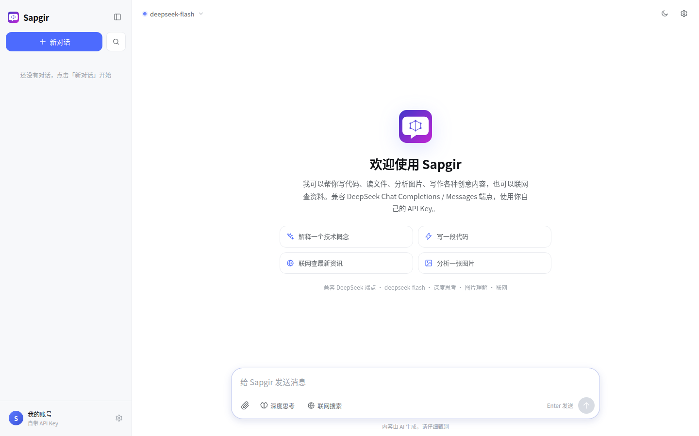
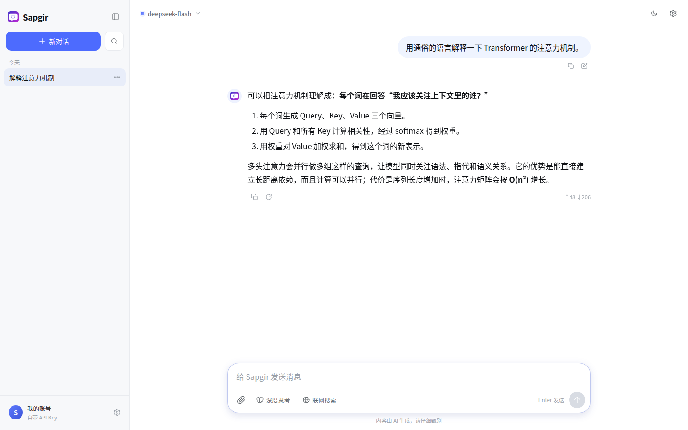
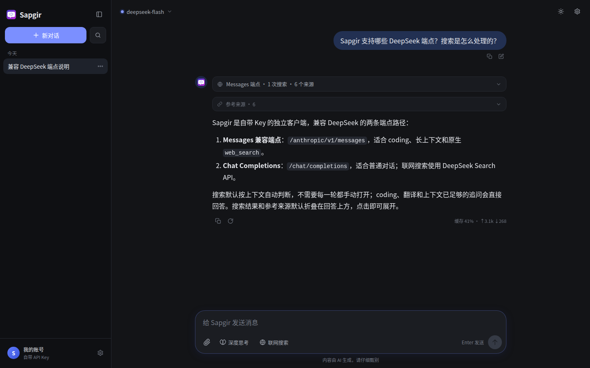
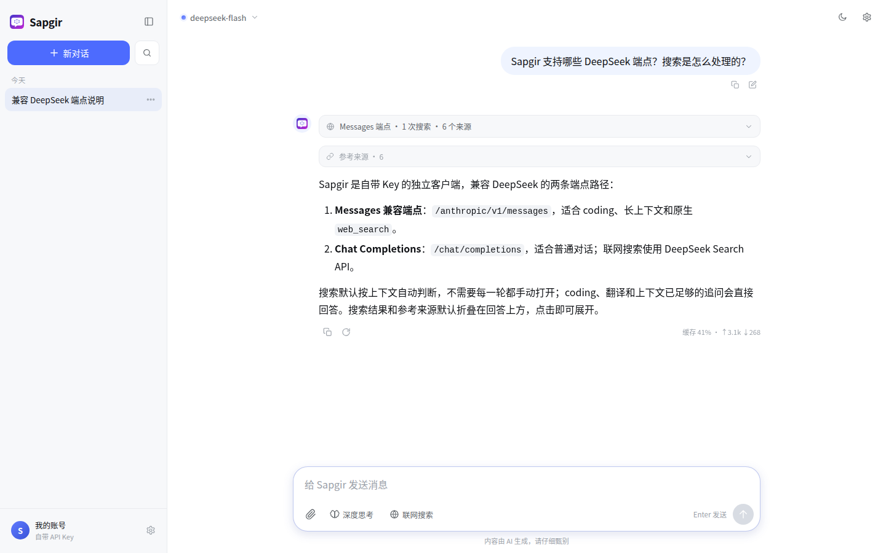
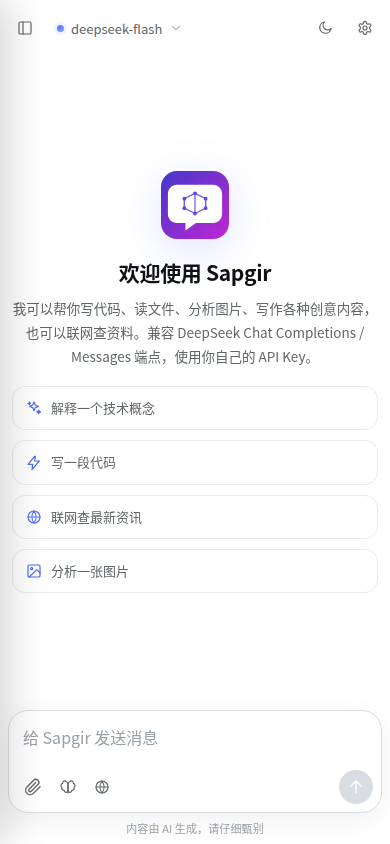

# Sapgir

> 兼容 OpenAI Chat Completions 协议的自带 Key AI 聊天扩展。
>
> 纯本地运行，无中转服务器、无遥测。

<p align="center">
  
</p>

<p align="center">
  
  
</p>

<p align="center">
  
</p>

<p align="center">
  
</p>

---

## 功能

- **自带 API Key**：连接任意兼容 Chat Completions 的服务；支持自定义 Base URL、模型名、测试连接和模型列表。
- **单一端点**：整轮对话固定走 `POST {baseUrl}/chat/completions`。
- **服务端联网**：输入框下方「联网搜索」开启时声明 `deepseek_web_search`，由模型自行决定是否搜索、搜索什么、是否打开页面；关闭后请求不携带联网工具。
- **两级思考**：输入框下方「深度思考」开启为 `reasoning_effort: max`，关闭为 `reasoning_effort: low`；两种情况都保留思考过程、实时展示耗时，可自动折叠。
- **多模态**：上传 / 粘贴 / 拖拽图片（JPG、PNG、GIF、WebP），自动压缩后以 base64 发送；支持多图、大图预览和历史图片回放。
- **稳定 system 快照**：对话开始时快照 system message，之后只追加可见消息，保持请求前缀稳定，提高前缀缓存命中。
- **完整 Markdown**：GFM 表格、任务列表、代码高亮、代码复制、引用链接、KaTeX 公式（`$...$`、`$$...$$`、`\(...\)`、`\[...\]`）。
- **本地优先**：对话和设置保存在 `chrome.storage.local`，可导出 / 导入备份，导出文件不包含 API Key。
- **附加能力**：文本文件附件、对话搜索、重命名、置顶、删除、Markdown 导出、右键菜单「用 AI 解释 / 总结页面」。

## 安装

要求 **Chrome / Edge 116+**。

1. 下载或克隆本目录。
2. 打开 `chrome://extensions/`，开启右上角 **开发者模式**。
3. 点击 **加载已解压的扩展程序**，选择本项目根目录（包含 `manifest.json` 的目录）。
4. 在工具栏固定扩展图标，点击图标即可打开聊天页。
5. 首次打开会自动弹出设置：
   - **API Key**：在服务提供方的控制台创建。
   - **Base URL**：默认 `https://api.deepseek.com`，填根地址即可；扩展会自动请求 `/chat/completions`。
   - **模型**：默认 `deepseek-flash`（支持图片理解）。
   - 可点击 **测试连接** 验证 Key 和网络。
   - **对话与工具**：可设置默认是否开启深度思考和联网搜索，并点击 **测试联网搜索**。
   - 点击 **保存**。

> 扩展页会在新标签页中打开；再次点击工具栏图标会聚焦已打开的页面，不会打断正在进行的对话。

## Android App

`android/` 提供了基于系统 WebView 的 Android 壳，复用本仓库的前端代码（构建时自动同步，不维护第二份副本），无需 Android Studio。主题设置为「跟随系统」时，Android 壳会读取系统日间/夜间模式并自动切换；显式选择浅色/深色时保持用户选择。

```bash
export JAVA_HOME=~/android-toolchain/jdk
export ANDROID_HOME=~/Android/Sdk
cd android && echo "sdk.dir=$ANDROID_HOME" > local.properties && ./gradlew assembleDebug
adb install -r app/build/outputs/apk/debug/app-debug.apk
```

要求 Android 10+（minSdk 29）。构建环境、签名和移动端适配细节见 [android/README.md](android/README.md)。

## 使用

- **发送**：`Enter` 发送，`Shift + Enter` 换行。可在设置中改为 `Ctrl/⌘ + Enter` 发送。
- **深度思考**：输入框左侧的「深度思考」按钮；开启为 max 强度，关闭为 low 强度，思考过程会实时显示，回答开始后自动折叠。
- **联网搜索**：输入框左侧的「联网搜索」按钮；开启后声明 `deepseek_web_search`，由模型决定是否搜索；关闭后请求不携带联网工具。搜索次数和来源会显示在回答上方，默认折叠。
- **图片**：点击回形针、直接粘贴截图，或把图片拖进页面；发送前可点击缩略图查看大图。
- **文本文件**：支持 `.txt / .md / .json / .csv / .py / .js / .ts / .html / .css / .sql / .yaml` 等常见文本文件。
- **对话管理**：侧边栏支持搜索、重命名、置顶、删除、导出 Markdown。
- **快捷操作**：
  - `Ctrl / ⌘ + K`：搜索对话
  - `Alt + N`：新对话
  - `Esc`：关闭菜单 / 弹窗
- **右键菜单**（在任意网页上）：
  - 「用 AI 解释“选中内容”」
  - 「用 AI 总结此页面」

## 模型与 API

扩展只使用 Chat Completions 兼容接口：

```text
POST {baseUrl}/chat/completions
Authorization: Bearer <API_KEY>
content-type: application/json
```

- 默认模型：`deepseek-flash`。
- 也支持 `deepseek-v4-pro`、`deepseek-chat`、`deepseek-reasoner` 或自定义模型名。
- 思考参数：始终 `thinking: { type: "enabled" }`；按钮关闭时 `reasoning_effort: "low"`，开启时 `reasoning_effort: "max"`。
- 图片以 base64 `image_url` content part 发送。
- 联网开关开启时声明服务端工具 `deepseek_web_search`；关闭时不发送 `tools`。

### 上下文与缓存

- 对话开始时快照一条 system message，之后不逐轮重写；
- 切换「联网搜索」时 system 快照会更新，因为模型需要知道本轮有没有搜索工具；
- 每轮从可见的 user / assistant 消息重建历史；
- 服务端搜索的工具调用不会跨轮重放；
- 消息下方会显示类似 `缓存 77% · ↑2.9k ↓420` 的用量信息。

### 联网搜索

- 输入框下方「联网搜索」开启时，请求中声明服务端工具：

  ```json
  {
    "type": "deepseek_web_search"
  }
  ```

- 模型决定是否搜索、搜索 query、是否打开页面；客户端不执行任何工具。
- 搜索、网页打开和正文注入都在服务端完成；客户端只接收 `server_tool_calls` / `server_tool_event` 中的来源列表用于展示。
- 服务端搜索本身不额外计费，只计模型 token；具体以服务提供方文档和账单为准。

## 数据与隐私

- API Key 只保存在当前浏览器的 `chrome.storage.local`，不会发送到本项目自己的服务器。
- 模型、图片、文件和联网搜索请求都只发送到你填写的 **Base URL**。
- 没有自建服务器、没有统计上报、没有远程配置。
- 导出的 JSON **不包含 API Key**。
- 本项目声明 `<all_urls>` 权限，用于自定义 Base URL 和右键总结页面。

> 本项目为独立第三方客户端，与任何模型或 API 提供方无隶属、背书或赞助关系。

## 已知限制

- **只支持 Chat Completions 兼容接口**。
- **联网由模型决定**：切换按钮只控制是否声明搜索工具；模型仍可能选择不搜索，也可能在一轮内多次搜索。
- **搜索依赖端点能力**：如果目标端点不支持 `deepseek_web_search`，请求可能失败或忽略该工具。
- **无客户端网页抓取**：不提供独立的 `web_fetch`；`deepseek_web_search` 的深度搜索会在服务端打开页面。
- **PDF / Word 暂不解析**：目前支持图片和常见文本文件。
- **GIF 会取首帧**。
- **公式**：支持 `$...$`、`$$...$$`、`\(...\)`、`\[...\]`；单美元公式使用保守判断，`$5-$10`、`$0.15` 这类货币不会被当作公式。

## 开发

无需构建工具，直接加载目录即可。

本地预览：

```bash
python3 -m http.server 8765
# 打开 http://127.0.0.1:8765/app.html
```

运行测试（Node 18+，使用内置 `node:test`）：

```bash
npm test
```

测试覆盖 Chat Completions SSE 解析、`server_tool_calls` 来源提取、图片 content part、旧设置清理和导出不含 Key。

### 目录结构

```text
.
├── manifest.json          # MV3 配置
├── package.json           # 仅用于 node:test，无运行时依赖
├── background.js          # Service Worker：打开/聚焦标签页、右键菜单
├── app.html               # 聊天主页面
├── styles/app.css         # 全部样式（自绘 UI）
├── js/
│   ├── app.js             # UI 状态、侧边栏、流式渲染、对话编排
│   ├── api.js             # Base URL、模型列表、system message
│   ├── chat.js            # Chat Completions 客户端、deepseek_web_search、流式解析
│   ├── settings-ui.js     # 设置表单、连接/搜索测试
│   ├── attachments.js     # 图片压缩、文件读取、附件预览
│   ├── tool-panel.js      # 搜索面板与参考来源渲染
│   ├── http.js            # host / 超时 / 错误响应解析
│   ├── storage.js         # chrome.storage.local
│   ├── markdown.js        # Markdown、代码高亮、引用、KaTeX
│   └── icons.js           # 内联图标
├── test/                  # node:test 单测
├── vendor/                # marked / DOMPurify / highlight.js / KaTeX
├── assets/                # 原创图标
├── screenshots/           # README 截图
└── android/               # Android WebView 壳（复用本目录前端代码）
```

### 第三方库

- [marked](https://github.com/markedjs/marked) — MIT
- [DOMPurify](https://github.com/cure53/DOMPurify) — Apache-2.0 / MPL-2.0
- [highlight.js](https://highlightjs.org/) — BSD-3-Clause
- [KaTeX](https://katex.org/) — MIT；字体 SIL OFL 1.1

完整声明见 [THIRD_PARTY_NOTICES.md](THIRD_PARTY_NOTICES.md)，许可证全文在 [`LICENSES/`](LICENSES/)。

## License

代码以 **MIT** 协议开源，详见 [LICENSE](LICENSE)。
